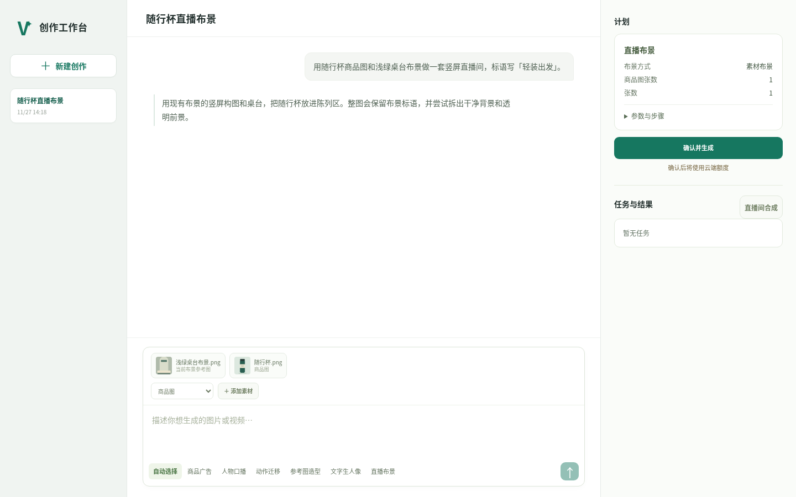
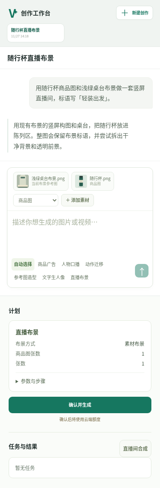
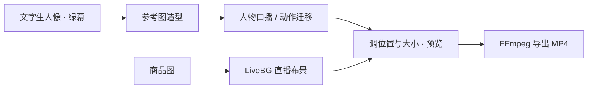
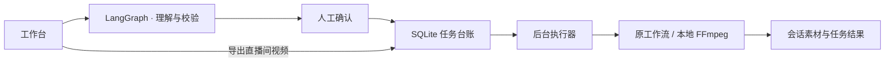

<div align="center">

# Video Agent Studio

**图像与视频创作工作台**

用中文对话规划图像和视频任务，在同一会话复用人物、商品和直播布景素材。


[工作流](#工作流) · [直播间合成](#直播间合成) · [快速启动](#快速启动) · [架构与任务恢复](#架构与任务恢复)

</div>



<details>
<summary>查看移动端工作台</summary>



</details>

## 工作流

上传素材并设置角色，发送需求，检查计划后点击「确认并生成」。在结果图旁点「用作人物参考图」或「用作布景参考图」，便可在同一会话继续创作。

| 工具 | 输入 | 输出 |
| --- | --- | --- |
| **文字生人像** | 地域风格、穿搭与画幅 | 坐姿正面半身人像，可选绿幕或蓝幕 |
| **参考图造型** | 人物图、服装／姿势／发型参考或描述 | 保留人物参考的换装和造型图 |
| **人物口播** | 人物图、完整文案，可选商品图与音色参考 | 分段生成后拼接的口播视频 |
| **动作迁移** | 人物图与驱动视频 | Wan 或 H3 Action 动作视频 |
| **商品广告** | 商品图与创作需求 | H3 广告、生活片或多视角特写视频 |
| **直播布景** | 商品图，可选带桌台的布景参考图 | 直播间整图及可用的干净背景、透明前景 |
| **直播间合成** | 同一会话的分层布景与人物素材 | 单帧构图预览、保留原声的 MP4 |

## 直播间合成

人物和布景可以分开制作。在「任务与结果」打开 **直播间合成**，选取两条工作流的结果。



1. **准备人物**。生成纯色绿幕人像，换装时写「保留纯色绿幕」。选中满意的结果作为人物参考图，再生成口播或动作视频。
2. **生成布景**。上传商品图选择 AI 电商展台或实景房间。有现成的带桌台参考图时，可选择素材布景。合成需要同一张布景的干净背景与透明前景。
3. **预览和导出**。选一张人物图先预览构图，或选视频预览具体时间点。调好幕布颜色、抠像强度和主播位置，再导出 MP4。

FFmpeg 在本机按 **干净背景 → 去幕布的主播 → 透明桌台与商品** 叠放。导出保留视频原声，不调用云端生成。抠像适用于保留纯色幕布的输入，普通场景中的人物分割需要单独的模型。

<details>
<summary>可直接使用的需求示例</summary>

| 场景 | 输入示例 |
| --- | --- |
| 文字生人像 | 生成一张 9:16 的通勤风绿幕主播图。 |
| 参考图造型 | 按服装参考图给人物换装，保留纯色绿幕和坐姿。 |
| 人物口播 | 主播不手持商品。口播文案：大家好，今天带大家看这款随行杯。 |
| 直播布景 | 用两张商品图做素材布景。商品名：随行杯。标语：轻装出发 |
| 商品广告 | 用这张商品图制作一条 10 秒竖屏生活广告。 |

素材布景默认取最新一张商品图，也可明确指定使用最近的 1–5 张。口播默认使用会话内的商品图生成持商品参考帧，并在视频生成前等待确认。商品应由桌台展示时，在需求中写「主播不手持商品」。

</details>

## 快速启动

准备 **Python 3.10+** 和 **FFmpeg**，确认 `ffmpeg`、`ffprobe` 均在 PATH 中。

```bash
git clone https://github.com/ZR-AI/video_agent_studio.git
cd video_agent_studio
python3 -m venv .venv
.venv/bin/python -m pip install -r requirements.lock
cp .env.example .env
./start.sh
```

打开 [http://127.0.0.1:8010](http://127.0.0.1:8010)。保留仓库目录名 `video_agent_studio`，启动脚本会以该名称导入 Python 包。每个数据目录使用一个服务进程。

### 配置规划器与生成服务

在 [.env.example](.env.example) 的基础上编辑本地 `.env`。设置 `DEEPSEEK_API_KEY` 启用 DeepSeek 规划，设置 `RUNNINGHUB_API_KEY` 供直接执行的口播流程使用。没有 DeepSeek Key 时使用本地规则规划，也可显式设置 `VIDEO_AGENT_PLANNER=rules`。生成仍依赖所选工具的后端配置。

| 独立服务 | 环境变量 | 默认地址 |
| --- | --- | --- |
| 商品视频工作台 | `PRODUCT_STUDIO_URL` | `http://127.0.0.1:8008` |
| 动作迁移工作台 | `MOTION_STUDIO_URL` | `http://127.0.0.1:8001` |
| Qwen 参考图造型 | `QWEN_IMAGE_STUDIO_URL` | `http://127.0.0.1:8190` |
| 人像灵感工坊 | `PORTRAIT_IMAGE_STUDIO_URL` | `http://127.0.0.1:8009` |
| LiveBG (`h3livebg_pkg`) | `BACKGROUND_STUDIO_URL` | `http://127.0.0.1:3099` |

这些服务分别启动，只需部署你要用的工作流。Qwen 造型连接 ComfyUI。人像与 LiveBG 使用各自的 DeepSeek、RunningHub 等配置。若服务只监听局域网 IP，环境变量应填写 Agent 机器能访问的地址。

<details>
<summary>口播、配置优先级与局域网</summary>

- `FL2VA_URL` 留空时，Agent 直接调用 DeepSeek 和 RunningHub。使用非 legacy 视频模式时，`FL2VA_VIDEO_MODE` 要与 `RUNNINGHUB_VIDEO_WORKFLOW_ID` 匹配。SeedVC 换音色需要 `RH_WORKFLOW_ID`。
- 配置按进程环境变量、本项目 `.env`、`KEY_SOURCE_FILE` 的顺序读取。共享配置默认来自相邻的 `../fl2va/web/.dev.vars`。若仓库旁有 `fl2va`，Agent 也会读取原项目的工作流 ID 与提示词。
- 局域网访问时，可在 `.env` 设置 `VIDEO_AGENT_HOST=0.0.0.0`，重启后用服务器的局域网 IP 和端口打开页面。工作台面向单用户或可信局域网，`X-App-Token` 用于校验 POST 请求。
- `.env`、运行时数据库、上传素材、成片和日志保存在本地。仓库只提供配置示例。

</details>

## 架构与任务恢复



- **计划与执行分开**。LangGraph 在确认前暂停，SQLite 保存检查点和作业。同一个计划重复确认会返回原任务。
- **恢复沿用原提交**。执行器记录原服务任务编号，口播还会逐段记录 RunningHub taskId。提交回执丢失时，先到原工作台核对并补录编号。已接单的任务不会因重复确认再次提交。
- **完成与质检独立记录**。动作质检可在原流程内有限重试，布景分层失败时仍会保留整图。最终生成费用以原服务为准。
- **暂停保留进度**。暂停会停止本地处理与轮询，已接受的云端任务可能继续运行。

| 文件 | 职责 |
| --- | --- |
| [`graph.py`](graph.py) · [`planner.py`](planner.py) | 对话规划、参数校验、确认检查点 |
| [`engine.py`](engine.py) · [`store.py`](store.py) | 后台执行、恢复与 SQLite 台账 |
| [`adapters/`](adapters/) | 原工作流的 API 与任务适配 |
| [`composition.py`](composition.py) | 会话内选材、本地抠像与分层合成 |
| [`app.py`](app.py) · [`static/`](static/) | FastAPI 与无构建前端 |

服务启动后可打开 [`/docs`](http://127.0.0.1:8010/docs) 查看 API。运行时数据位于 `data/`。

## 本地验证

从克隆目录的父目录运行：

```bash
video_agent_studio/.venv/bin/python -m pytest video_agent_studio/tests -q
node --check video_agent_studio/static/app.js
```

测试覆盖计划确认、素材复用、提交防重、断点恢复和真实本地 FFmpeg 合成。云服务接口使用模拟响应，验证过程不消耗生成额度。
